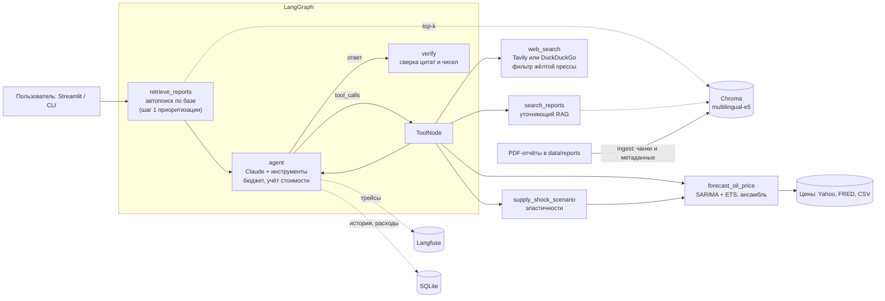
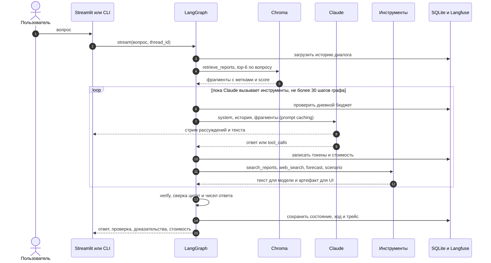
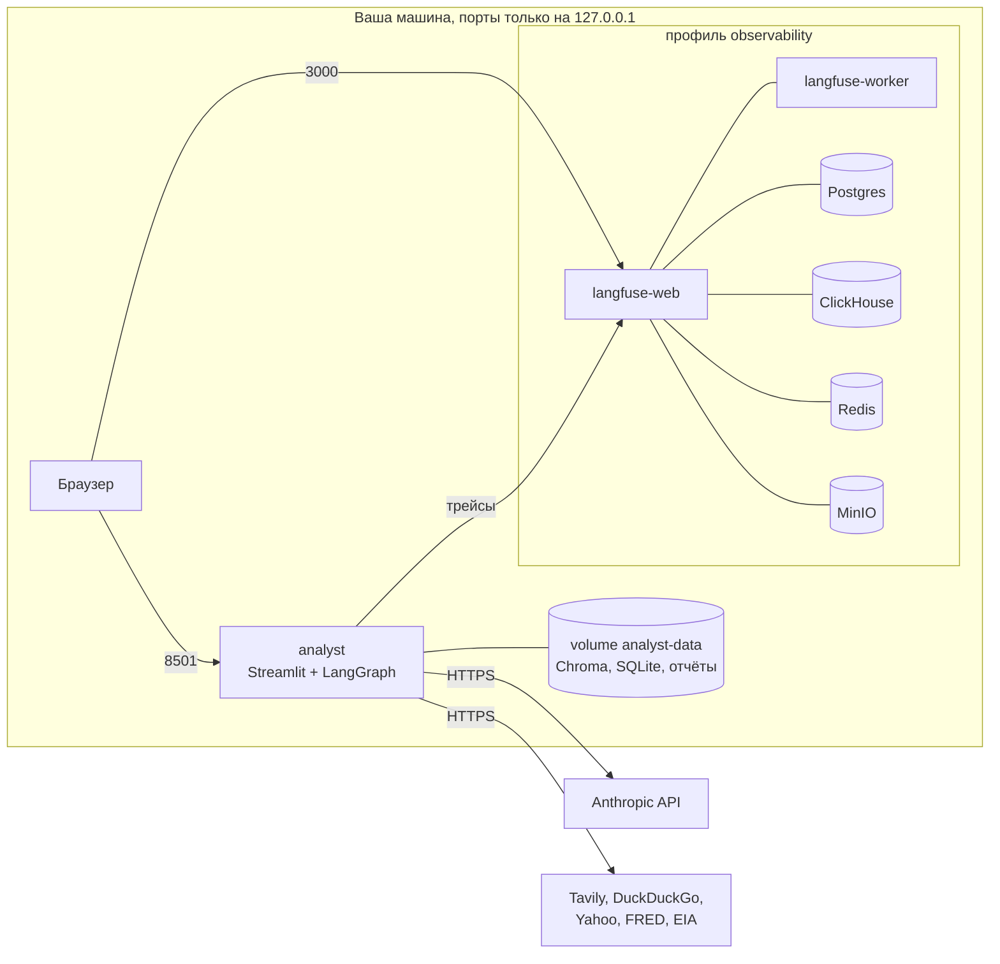

# 🛢️ AI-агент «Нефтегазовый аналитик» (LangGraph + Claude)

Агент в роли **Старшего аналитика нефтегазового рынка**: отвечает на отраслевые вопросы,
ищет сначала в базе отчётов агентств (RAG по OPEC MOMR / EIA STEO / IEA OMR), дополняет
свежими данными из интернета (с отсевом жёлтой прессы), сам решает, когда вызывать расчётный
модуль прогноза цен (SARIMA + ETS, сценарии шока предложения), и явно маркирует происхождение
каждой цифры.

Стек: Python 3.10+, LangGraph/LangChain, Claude (Opus 5.5 или Sonnet 5.5 через Anthropic API),
Chroma + multilingual-e5, Tavily/DuckDuckGo, statsmodels, Streamlit, Langfuse (self-hosted), Docker.

Готов к локальной эксплуатации одним пользователем: трейсинг каждого хода, учёт стоимости и
дневной лимит расходов, проверка цитат и чисел в ответе, стриминг, история диалогов, prompt caching,
автообновление базы отчётов.

---

## Содержание
- [Быстрый старт](#быстрый-старт)
- [Архитектура](#архитектура)
- [Наблюдаемость и объяснимость](#наблюдаемость-и-объяснимость)
- [Примеры запросов](#примеры-запросов)
- [Структура проекта](#структура-проекта)
- [Отчёт: решения, ограничения, что улучшить](#отчёт-решения-ограничения-что-улучшить)

---

## Быстрый старт

### Docker (одна команда)
```bash
python scripts/init_env.py  # .env из .env.example + сгенерированные секреты Langfuse/БД
# впишите в .env ANTHROPIC_API_KEY (и по желанию TAVILY_API_KEY)
docker compose up --build   # аналитик → http://localhost:8501, Langfuse → http://localhost:3000
```
Поднимаются аналитик и self-hosted Langfuse (web, worker, Postgres, ClickHouse, Redis, MinIO).
Нужно ~4 ГБ RAM под контейнеры — в Docker Desktop выделите не меньше 6–8 ГБ (Settings → Resources);
первая сборка скачивает ~3 ГБ образов и модель эмбеддингов. Без трейсинга: `python scripts/init_env.py --no-tracing` — тогда только аналитик.
Все порты привязаны к `127.0.0.1`. При первом старте контейнер проиндексирует PDF из
`data/reports`; индекс, история диалогов и учёт расходов живут в volume `analyst-data`.
Вход в Langfuse: `admin@local.test` и пароль `LANGFUSE_INIT_USER_PASSWORD` из `.env`.

### Локально
```bash
python3.12 -m venv .venv && source .venv/bin/activate
pip install -e '.[ui,dev]'
cp .env.example .env                 # ключи
oilgas download-reports --months 3   # EIA STEO за 3 месяца (+ OPEC MOMR, если доступен)
oilgas ingest                        # чанкинг + эмбеддинги + Chroma
streamlit run app/streamlit_app.py   # UI → http://127.0.0.1:8501
```
Настройки сервера — в [`.streamlit/config.toml`](.streamlit/config.toml): только `127.0.0.1`, без вотчера
исходников и телеметрии. Открывайте по IP: сервер слушает IPv4, а Safari для `localhost` может
сначала пробовать IPv6.

CLI без UI:
```bash
oilgas ask "Какой прогноз спроса на нефть на 2027 год даёт EIA?"
oilgas chat                                  # диалог в терминале
oilgas forecast --benchmark brent --horizon 6 --confidence 0.95   # расчётный модуль без LLM
oilgas scenario -1.5 --horizon 6             # сокращение добычи на 1.5 млн б/с
oilgas refresh                               # обновить базу: новые STEO + индекс + снимок цен
oilgas usage                                 # расходы за сегодня и последние диалоги
python scripts/run_demo.py                   # 5 демо-сценариев → demo/transcripts.md
pytest                                       # тесты (без обращений к LLM)
```

### Конфигурация
Все параметры — через `.env` (см. [`.env.example`](.env.example)): ключи API, модель
(`claude-opus-5-5` или `claude-sonnet-5-5`; в UI переключается в боковой панели) и её `effort`, prompt caching, дневной лимит расходов (`DAILY_BUDGET_USD`), модель эмбеддингов, размер
чанков, top-k, порог релевантности, интервал автообновления базы, трейсинг Langfuse, глубина истории
цен, объём мирового предложения для сценариев.

---

## Архитектура

### Обзор
Система — один Python-пакет `oilgas_analyst` и тонкие интерфейсы над ним. Слои:

| Слой | Что в нём | Где |
|---|---|---|
| Интерфейсы | Streamlit-чат, CLI `oilgas`, скрипт демо | `app/`, `cli.py`, `scripts/` |
| Оркестрация | LangGraph-граф хода: автопоиск по отчётам → агент ⇄ инструменты → проверка; стриминг событий, бюджет, трейсинг | `agent.py`, `prompts.py`, `observability.py` |
| Возможности (инструменты) | RAG по отчётам, веб-поиск с фильтром источников, прогноз цены, сценарий шока предложения | `tools.py`, `rag/`, `web/`, `forecasting/` |
| Объяснимость | Детерминированная сверка цитат и чисел ответа с полученными данными | `verification.py` |
| Данные и состояние | PDF-отчёты и каталог, Chroma, снимок цен, SQLite (состояние агента, диалоги, расходы), Langfuse | `data/`, `storage.py`, `refresh.py` |

Claude отвечает только за рассуждение и выбор инструментов; всё, что можно сделать кодом, сделано
кодом: шаг 1 приоритизации, метки источников, расчёты, проверка ответа, учёт стоимости.

### Компоненты и потоки данных



### Жизненный цикл одного хода



### Граф и его состояние
- **Состояние** — `AnalystState`: список сообщений (append-only, LangGraph `add_messages`) и
  результат последней проверки (`verification`). История хранится в SQLite через
  `SqliteSaver`, ключ — `thread_id` диалога.
- **`retrieve_reports`** — без LLM. Ищет top-k фрагментов по тексту вопроса и добавляет их в историю
  отдельным пользовательским сообщением с пометкой `rag_context`. В API Claude оно склеивается с
  вопросом в один user-ход; служебные поля (`sources`, тексты для UI) в запрос не попадают.
- **`agent`** — Claude с привязанными инструментами. Перед вызовом проверяет дневной бюджет, после —
  пишет токены и стоимость. Маршрут дальше выбирает `tools_condition`: есть `tool_calls` → `tools`,
  нет → `verify`.
- **`tools`** — `ToolNode`. Каждый инструмент возвращает пару «текст для модели + артефакт»: текст
  уходит в контекст Claude, артефакт (источники, данные графиков, отсеянные сайты) хранится в
  `ToolMessage.artifact` и нужен только UI и проверке.
- **`verify`** — без LLM. Собирает доказательства со всего диалога и сверяет с ними ответ; результат
  кладёт в состояние, он показывается бейджем и во вкладке «Проверка».

### Почему так устроено (инварианты)
- **Шаг 1 — код, а не просьба в промпте.** Отчёты попадают в контекст до первого вызова модели,
  поэтому правило «сначала база отчётов» выполняется всегда.
- **Append-only история.** Ничего не переписывается задним числом — так работают prompt caching
  (префикс запроса стабилен между шагами и ходами) и thinking-блоки Claude, привязанные к истории.
- **Модель видит только то, что ей нужно.** Тексты для UI, данные графиков и метаданные живут в
  артефактах и `additional_kwargs`, а не в промпте — меньше токенов и нет утечки служебных полей.
- **Метки источников вычисляются при индексации.** У каждого чанка готовая строка
  `[Отчёт EIA STEO, октябрь 2026, стр. 12]`; модель копирует её, а не собирает, а `verify`
  сверяет именно её.
- **Конфигурация — одна точка.** `Settings` (pydantic-settings) читает `.env`; пути данных
  выводятся из `DATA_DIR`, плейсхолдеры ключей считаются «не задано».

### Данные и хранилища

| Что | Где | Кто пишет | Кто читает |
|---|---|---|---|
| PDF-отчёты и каталог (издатель, название, дата, URL) | `data/reports/*.pdf`, `catalog.json` | `oilgas download-reports`, автообновление, загрузка в UI | индексация, просмотр страниц PDF в UI |
| Векторный индекс (чанки 1200/200 + метаданные) | `data/chroma/` | `oilgas ingest`, автообновление | `retrieve_reports`, `search_reports` |
| Снимок цен Brent/WTI (офлайн-резерв) | `data/prices/*.csv` | автообновление, `oilgas snapshot-prices` | расчётный модуль, если Yahoo и FRED недоступны |
| Состояние агента: сообщения, thinking-блоки | `data/checkpoints.sqlite` | граф (checkpointer) | граф на следующем ходе |
| Диалоги, отрисованные ходы, расходы, метаданные | `data/app.sqlite` | `OilGasAnalyst`, агент, автообновление | UI (история, расходы), бюджет, `oilgas usage` |
| Трейсы | Langfuse (Postgres + ClickHouse + MinIO) | Langfuse SDK через колбэки LangChain | вы, в UI Langfuse |

### Офлайн-конвейеры
- **Индексация:** PDF → текст по страницам (pypdf) → чанки (`RecursiveCharacterTextSplitter`) →
  метаданные и готовая метка → эмбеддинги multilingual-e5 (`passage:`) → Chroma (cosine).
  Идемпотентна: уже проиндексированные файлы пропускаются.
- **Автообновление:** фоновый поток в процессе UI проверяет раз в час, прошло ли
  `REFRESH_INTERVAL_DAYS`; если да — скачивает новые выпуски STEO, индексирует их и обновляет снимок
  цен. Работает в том же процессе, что и поиск, поэтому с Chroma пишет один клиент.

### Развёртывание



Без Docker то же самое запускается одним процессом (`streamlit run`) с данными в `./data`;
Langfuse в этом режиме необязателен.

### Отказоустойчивость

| Что сломалось | Что происходит |
|---|---|
| Tavily недоступен или нет ключа | DuckDuckGo: новости → HTML-версия → текстовый поиск |
| Yahoo Finance не отдаёт цены | до 3 повторов, затем спот EIA через FRED, затем CSV-снимок (источник указан в ответе) |
| База отчётов пуста или недоступна | шаг 1 сообщает об этом модели, агент идёт в веб |
| Langfuse не поднят | ответы работают, трейсы отправляются в фоне и отбрасываются |
| Достигнут дневной лимит | агент не вызывает модель и сообщает о лимите |
| Классификатор безопасности отклонил запрос | server-side fallback повторяет его на подходящей модели |
| Ошибка инструмента | `ToolNode` возвращает её модели как результат, агент продолжает |

### Как агент приоритизирует источники
1. **Перед каждым ответом** узел `retrieve_reports` детерминированно ищет по базе отчётов и
   кладёт top-k фрагментов в контекст хода — с метками `[Отчёт EIA STEO, октябрь 2026, стр. 12]`
   и оценкой релевантности (выше/ниже порога). Модель всегда видит отчёты первыми.
2. Если фрагментов достаточно — Claude отвечает по ним. Если нет — уточняет поиск
   (`search_reports`, английский запрос под англоязычные отчёты, фильтр по издателю).
3. `web_search` — когда нужна актуальность (новости, текущие котировки, решения ОПЕК+,
   санкции) или в отчётах ответа нет.
4. Системный промпт требует маркировать каждую цифру: `[Отчёт …]`, `[Источник: Reuters, web, дата]`,
   `[Расчёт: модуль прогноза]`, и завершать ответ разделом «Источники». Узел `verify` проверяет,
   что каждая метка соответствует реально полученному источнику.

### Модули

| Модуль | Что делает |
|---|---|
| [`prompts.py`](oilgas_analyst/prompts.py) | Роль «Старший аналитик», экспертиза (Upstream/Midstream/Downstream, Brent/WTI/Urals, ОПЕК+, санкции, баланс), стиль, правила при нехватке данных, поведение вне компетенции |
| [`rag/store.py`](oilgas_analyst/rag/store.py) | PDF → страницы (pypdf) → чанки 1200/200 (RecursiveCharacterTextSplitter) с метаданными: файл, издатель, название, дата, **страница**, готовая метка источника. Chroma (cosine), top-k с score |
| [`rag/embeddings.py`](oilgas_analyst/rag/embeddings.py) | `intfloat/multilingual-e5-*` с префиксами `query:`/`passage:` — вопросы на русском, отчёты на английском |
| [`rag/catalog.py`](oilgas_analyst/rag/catalog.py) | Каталог отчётов `data/reports/catalog.json` (издатель/название/дата/URL), угадывание по имени файла |
| [`web/search.py`](oilgas_analyst/web/search.py) | Tavily (`exclude_domains` = чёрный список) с fallback на DuckDuckGo |
| [`web/source_filter.py`](oilgas_analyst/web/source_filter.py) | Фильтр жёлтой прессы: чёрный список (таблоиды RU/EN, конспирология, соцсети/UGC), эвристика кликбейта (капслок, «шок», «you won't believe»), уровни доверия: официальные (OPEC/IEA/EIA/Минэнерго) → агентства и деловые СМИ → непроверенные |
| [`forecasting/data.py`](oilgas_analyst/forecasting/data.py) | История цен: yfinance (BZ=F, CL=F) → FRED (EIA spot) → CSV-снимок; среднемесячные цены |
| [`forecasting/models.py`](oilgas_analyst/forecasting/models.py) | SARIMA (подбор порядка по AIC) и ETS с затухающим трендом на log-ценах; скользящий бэктест → веса ансамбля 1/MAPE; интервал — огибающая интервалов моделей |
| [`forecasting/scenario.py`](oilgas_analyst/forecasting/scenario.py) | Шок предложения: ΔlnP ≈ −ΔlnQ / (ε_s + \|ε_d\|), три сценария эластичности по литературе, компенсация другими производителями, постепенный вход |
| [`agent.py`](oilgas_analyst/agent.py) | Граф LangGraph, Claude через `langchain-anthropic` (prompt caching, server-side fallback), бюджет и учёт стоимости, SQLite-checkpointer, стриминг событий хода |
| [`verification.py`](oilgas_analyst/verification.py) | Детерминированная проверка ответа: метки источников ↔ реально найденные фрагменты/веб/расчёты, числа ↔ тексты источников |
| [`observability.py`](oilgas_analyst/observability.py) | Langfuse-трейсинг (сессия = диалог, ссылка на трейс), цены моделей и стоимость вызова с учётом кэша |
| [`storage.py`](oilgas_analyst/storage.py) | SQLite: список диалогов, отрисованные ходы, расходы по каждому вызову, метаданные |
| [`translate.py`](oilgas_analyst/translate.py) | Перевод резюме рассуждений на язык вопроса (Haiku 5.5, фоновый пул, в учёт стоимости) |
| [`refresh.py`](oilgas_analyst/refresh.py) | Автообновление базы: новые выпуски STEO, переиндексация, снимок цен (фоновый поток раз в N дней) |
| [`app/streamlit_app.py`](app/streamlit_app.py) | Стриминг шагов и ответа, вкладки «Доказательства / Путь решения / Проверка / Рассуждения», страницы PDF, график прогноза, история диалогов, расходы, обновление базы |

---

## Наблюдаемость и объяснимость

### Трейсинг (Langfuse, self-hosted)
Каждый ход — один трейс: узлы графа, каждый вызов Claude (промпт, ответ, токены, кэш, задержка),
вызовы инструментов с аргументами и результатами. Трейсы диалога сгруппированы в сессию
(`thread_id`), теги — модель. У каждого ответа в UI есть ссылка «трейс в Langfuse ↗». Langfuse
поднимается в том же `docker compose`, данные никуда не уходят; если он недоступен, ответы
продолжают работать (трейсы отправляются в фоне).

### Стоимость и лимит
Стоимость каждого вызова считается по `usage` ответа с учётом prompt caching (чтение кэша — $0.20/M
для Opus/Sonnet 5.5, запись — ×1.25 к цене входа) и пишется в SQLite. В UI — стоимость, токены и
кэш у каждого ответа, полоса расходов за день. `DAILY_BUDGET_USD` — жёсткий лимит: при его
достижении агент не вызывает модель и честно сообщает об этом. На практике ход стоит $0.04–0.15
на Opus 5.5; повторные ходы диалога в 2–3 раза дешевле за счёт кэша.

### Объяснимость ответа
- **Проверка цитат и чисел** (узел `verify`, без LLM). Каждая метка `[Отчёт …, стр. N]` сверяется с
  фрагментами, которые агент реально получил в диалоге (отчёт + месяц + страница), `[Источник: …, web]` —
  с веб-выдачей, `[Расчёт: …]` — с вызовами модуля. Числа из ответа ищутся в текстах источников и выводе
  инструментов с точностью до разряда. Итог — бейдж «цитаты 18/19 · числа 48/52» и список
  неподтверждённого с контекстом (обычно это арифметика или оценка аналитика — их видно сразу).
- **Доказательства.** Фрагменты отчётов с оценкой близости, 📌 — страница процитирована; по клику —
  сама страница PDF; веб-источники с уровнем доверия и список отсеянного фильтром жёлтой прессы.
- **Путь решения.** Шаг 1 (автопоиск по базе: сколько найдено и насколько релевантно) → реплики модели
  → вызовы инструментов с аргументами → краткие результаты → проверка.
- **Рассуждения.** Краткое изложение хода мыслей Claude (thinking summary). API отдаёт его
  по-английски, поэтому каждый фрагмент в фоне переводится на язык вопроса (Claude Haiku 5.5, доли
  цента за ход, учитывается в стоимости); оригинал доступен рядом. Переведённые фрагменты видны и
  вживую, пока агент работает.
- **Прогноз.** Вклад моделей ансамбля, MAPE бэктеста и веса; для сценариев — допущения и эффекты.

### Надёжность и UX
- **Стриминг:** пока агент работает, над ответом — свёрнутый статус с текущим этапом
  («🔎 Ищу в отчётах…», «🌐 Ищу в интернете…», «✍️ Пишу ответ…»; полный лог — по раскрытию), текст
  ответа печатается по мере генерации. Ход идёт 20–90 с.
- **Смена модели посреди диалога:** Opus и Sonnet переключаются в боковой панели без потери контекста —
  состояние диалога общее, история append-only, thinking-блоки другой модели API игнорирует. Кэш
  промпта у каждой модели свой, поэтому первый ответ после переключения чуть дороже.
- **История:** диалоги и состояние агента (включая thinking-блоки) хранятся в SQLite и переживают
  перезапуск; список диалогов — в боковой панели.
- **Prompt caching:** автоматическая точка кэша на конце запроса — инструменты, системный промпт и
  история переиспользуются между шагами tool-loop и ходами диалога.
- **Автообновление базы:** раз в `REFRESH_INTERVAL_DAYS` фоновый поток скачивает новые выпуски STEO,
  индексирует их и обновляет снимок цен; плюс кнопка «Обновить базу сейчас» и `oilgas refresh`.

---

## Примеры запросов

| Тип | Запрос | Что делает агент |
|---|---|---|
| Отчёт | «Какой прогноз мирового спроса на 2026–2027 даёт EIA?» | Отвечает по автопоиску в STEO, метки страниц |
| Веб | «Что ОПЕК+ решила на последней встрече?» | Отчёты не покрывают свежие решения → `web_search` (новости, 30 дней) |
| Комбинированный | «Цена Brent сейчас выше или ниже прогноза EIA?» | Прогноз из STEO + текущая котировка из веба, расхождение и причины |
| Расчёт | «Спрогнозируй Brent на 3 месяца» | `forecast_oil_price` → таблица, интервал, интерпретация + фундаментальный контекст |
| Сценарий | «Диапазон цен, если ОПЕК+ сократит добычу на 1,5 млн б/с» | `supply_shock_scenario(-1.5)` → три сценария эластичности + статистический интервал |
| Вне компетенции | «Как приготовить борщ?» | Вежливый отказ, без вызова инструментов |

Полные диалоги — в [`demo/transcripts.md`](demo/transcripts.md) (генерируются `scripts/run_demo.py`).

---

## Структура проекта

```
oilgas_analyst/          ядро
  agent.py               LangGraph-граф, стриминг, бюджет, учёт стоимости
  verification.py        проверка цитат и чисел
  observability.py       Langfuse, цены и стоимость
  storage.py             SQLite: диалоги, ходы, расходы
  refresh.py             автообновление базы
  translate.py           перевод резюме рассуждений
  prompts.py             системный промпт роли
  tools.py               LangChain-инструменты (content + artifact)
  config.py              настройки из .env
  cli.py                 CLI: ingest / download-reports / ask / chat / forecast / scenario
  rag/                   каталог, загрузка, эмбеддинги, Chroma
  web/                   поиск и фильтр источников
  forecasting/           данные, модели, сценарии, фасад
app/streamlit_app.py     UI
.streamlit/config.toml   режим эксплуатации Streamlit (без вотчера, только 127.0.0.1)
scripts/run_demo.py      прогон демо-сценариев
scripts/init_env.py      .env + генерация секретов для docker compose
data/reports/            PDF-отчёты + catalog.json
data/prices/             снимок цен (офлайн-резерв)
tests/                   pytest (без обращений к LLM)
docs/                    заметки (в т.ч. отложенный эксперимент с Ouroboros)
demo/transcripts.md      демонстрационные диалоги
Dockerfile, docker-compose.yml, docker/entrypoint.sh
```

---

## Отчёт: решения, ограничения, что улучшить

### Принятые решения и почему

**LLM — Claude: Opus 5.5 по умолчанию, Sonnet 5.5 как быстрая альтернатива.** Надёжный tool
calling в многошаговых сценариях (агент сам решает, звать ли RAG повторно, веб или расчёт), сильный
русский язык, 1M контекст (десятки фрагментов отчётов без обрезки), дисциплина в цитировании
источников и отказе выдумывать цифры. Opus 5.5 (`$4/$20` за 1M токенов) — глубже анализ и сведение
противоречивых источников; Sonnet 5.5 (`$2/$10`) — быстрее и вдвое дешевле, для простых вопросов
разницы почти нет. Модель выбирается в UI или переменной `LLM_MODEL`. `effort=medium` — баланс
качества и стоимости (для сложных вопросов — `high`). Включён server-side fallback (beta): если
классификатор безопасности ложно сработает на «санкции/эмбарго», запрос автоматически повторится на
подходящей модели.

**RAG-first как узел графа, а не только инструкция.** Требование «сначала отчёты» выполняется
детерминированно: автопоиск идёт до LLM, а не на усмотрение модели. Модель при этом сохраняет
свободу уточнить поиск или уйти в веб. Контекст хранится в истории как часть пользовательского хода
(append-only) — так не ломаются кэширование промпта и thinking-блоки между ходами.

**multilingual-e5 + Chroma.** Отчёты на английском, вопросы — на русском: нужна кросс-языковая
модель. E5 даёт хорошее качество на CPU; по умолчанию `-small` (быстрый старт в Docker),
`-base/-large` — одной переменной. Chroma — встраиваемая БД без отдельного сервиса, персистентная,
с фильтрацией по метаданным (издатель).

**Метка источника формируется при индексации.** Каждый чанк хранит готовую строку
`[Отчёт EIA STEO, октябрь 2026, стр. 12]` — модель копирует её, а не собирает сама, это убирает
галлюцинации номеров страниц и дат.

**Фильтр жёлтой прессы — три слоя.** Чёрный список доменов передаётся в Tavily `exclude_domains`
(не тратим квоту) и повторно применяется локально (для DDG); эвристика кликбейта по заголовку;
уровни доверия источников, которые видит модель. Надёжные домены не блокируются эвристикой
(у Reuters тоже бывают громкие заголовки).

**Прогноз: SARIMA + ETS на log-ценах, ансамбль по бэктесту.** Две разные по природе модели
(ARIMA-динамика и сглаживание с затухающим трендом), веса — по ошибке скользящего бэктеста, а не
поровну. Log-преобразование даёт асимметричные интервалы. Интервал ансамбля — огибающая (консервативно).
Модуль отдаёт не только числа, но и интерпретацию и ограничения — агенту есть из чего строить ответ.

**Сценарии шока предложения — на эластичностях, а не «чёрный ящик».** Задача «сокращение на N
млн б/с» требует причинной модели, которой у статистических рядов нет. Стилизованная модель частичного
равновесия с диапазоном эластичностей из литературы прозрачна и даёт честный диапазон.

### Ограничения текущей реализации
- **Корпус отчётов.** Автоматически скачиваются только EIA STEO (публичный домен) и архивный OPEC MOMR
  (октябрь 2025) с зеркала: сайты OPEC и IEA закрыты Cloudflare/подпиской, свежие выпуски нужно положить
  в `data/reports` вручную или загрузить через UI. IEA OMR полностью — платный.
- **Таблицы в PDF** извлекаются pypdf как текст: числа из сложных таблиц STEO иногда теряют привязку к
  строке/столбцу. Модель предупреждена не выдумывать, но может не найти цифру, которая есть в таблице.
- **Источник цен.** По умолчанию — фьючерс Brent/WTI (Yahoo Finance); если Yahoo недоступен даже после
  повторов, модуль берёт спот EIA через FRED (с лагом ~неделю) или CSV-снимок. Источник указан в ответе
  модуля, но при сильной бэквордации спот и фьючерс расходятся на $10+ (см. демо, сценарий 4).
- **Прогноз** — экстраполяция ряда: не учитывает фундаментальные факторы, интервалы на горизонте 6+ мес.
  широкие (±25–30%). Urals не моделируется (нет надёжного открытого ряда) — агент объясняет это.
- **Сценарный модуль** не моделирует запасы, резервные мощности, ожидания рынка (ожидаемое решение
  ОПЕК+ уже частично в цене).
- **Порог релевантности RAG** (0.84 для e5-small) подобран эвристически; для e5-base/large его стоит перекалибровать.
- **Фильтр источников** основан на списках: новый таблоид вне списка пройдёт как «непроверенный»
  (уровень 3), если заголовок не кликбейтный.
- **Проверка цитат — эвристика.** Метки разбираются регулярными выражениями; нестандартную форму
  цитаты она пропустит, а число, совпавшее с источником случайно, засчитает. Это страховочный слой,
  а не фактчекинг: он ловит выдуманные страницы и источники, но не неверную интерпретацию цифры.
- **Автопоиск по русскому вопросу** даёт более низкие оценки близости (кросс-языковой поиск), поэтому
  часто «0 релевантных» на шаге 1 — агент затем уточняет поиск по-английски, это видно в «Пути решения».
- **Один пользователь:** нет авторизации (порты только на `127.0.0.1`), SQLite не рассчитан на
  параллельную работу многих пользователей.
- **Веб-поиск без ключа** (DuckDuckGo) нестабилен и иногда ограничивает частоту запросов.

### Что улучшил бы при наличии времени
1. **Парсинг таблиц** (pdfplumber/camelot или LLM-извлечение) → отдельная структурированная БД
   ключевых рядов (спрос/предложение по регионам, прогнозы цен) с SQL-инструментом для точных цифр.
2. **Гибридный поиск внутри RAG**: BM25 + векторы + reranker (bge-reranker) — цифры, тикеры и
   аббревиатуры (MOMR, DoC, NGL) ищутся лексически лучше, чем семантически.
3. **Факторная модель цены**: регрессия на запасы OECD, спреды, позиционирование CFTC, курс доллара;
   Prophet/LSTM в ансамбль; вероятностная калибровка интервалов (CRPS, coverage на бэктесте).
4. **Оценка качества агента**: набор эталонных вопросов с ожидаемыми источниками/цифрами,
   LLM-as-judge на точность цитирования и галлюцинации, регрессионные прогоны в CI.
5. **Классификатор надёжности источников** (вместо списков) + проверка фактов по нескольким источникам.
6. **Перевод запроса для шага 1** (дешёвая модель Haiku): автопоиск по базе на английском сразу,
   без уточняющего вызова; авторизация и Postgres-checkpointer для нескольких пользователей.
7. **Ряд Urals** из открытых источников (дисконт к Brent) — сейчас агент оценивает Urals через Brent.
