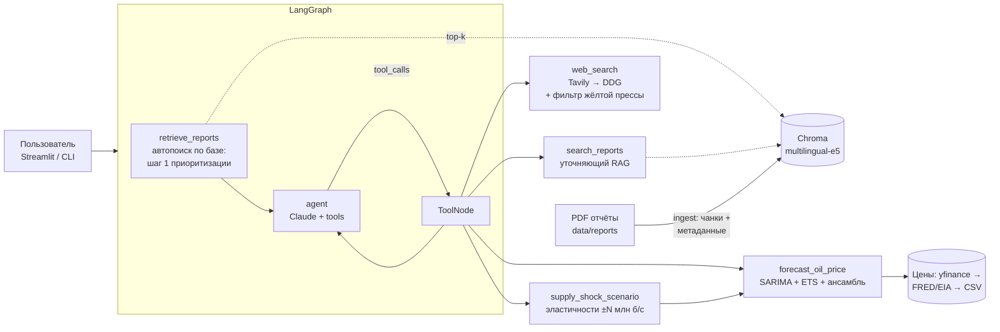

# 🛢️ AI-агент «Нефтегазовый аналитик» (LangGraph + Claude)

Агент в роли **Старшего аналитика нефтегазового рынка**: отвечает на отраслевые вопросы,
ищет сначала в базе отчётов агентств (RAG по OPEC MOMR / EIA STEO / IEA OMR), дополняет
свежими данными из интернета (с отсевом жёлтой прессы), сам решает, когда вызывать расчётный
модуль прогноза цен (SARIMA + ETS, сценарии шока предложения), и явно маркирует происхождение
каждой цифры.

Стек: Python 3.10+, LangGraph/LangChain, Claude (Opus 5.5 или Sonnet 5.5 через Anthropic API),
Chroma + multilingual-e5, Tavily/DuckDuckGo, statsmodels, Streamlit, Docker.

---

## Содержание
- [Быстрый старт](#быстрый-старт)
- [Архитектура](#архитектура)
- [Примеры запросов](#примеры-запросов)
- [Структура проекта](#структура-проекта)
- [Отчёт: решения, ограничения, что улучшить](#отчёт-решения-ограничения-что-улучшить)

---

## Быстрый старт

### Docker (одна команда)
```bash
cp .env.example .env        # впишите ANTHROPIC_API_KEY (и по желанию TAVILY_API_KEY)
docker compose up --build   # → http://localhost:8501
```
При первом старте контейнер проиндексирует PDF из `data/reports` (если папка пуста — скачает
свежие EIA STEO). Индекс Chroma хранится в volume `analyst-data` и переживает пересборку.

### Локально
```bash
python3.12 -m venv .venv && source .venv/bin/activate
pip install -e '.[ui,dev]'
cp .env.example .env                 # ключи
oilgas download-reports --months 3   # EIA STEO за 3 месяца (+ OPEC MOMR, если доступен)
oilgas ingest                        # чанкинг + эмбеддинги + Chroma
streamlit run app/streamlit_app.py   # UI
```

CLI без UI:
```bash
oilgas ask "Какой прогноз спроса на нефть на 2027 год даёт EIA?"
oilgas chat                                  # диалог в терминале
oilgas forecast --benchmark brent --horizon 6 --confidence 0.95   # расчётный модуль без LLM
oilgas scenario -1.5 --horizon 6             # сокращение добычи на 1.5 млн б/с
python scripts/run_demo.py                   # 5 демо-сценариев → demo/transcripts.md
pytest                                       # тесты (без обращений к LLM)
```

### Конфигурация
Все параметры — через `.env` (см. [`.env.example`](.env.example)): ключи API, модель
(`claude-opus-5-5` или `claude-sonnet-5-5`; в UI переключается в боковой панели) и её `effort`, модель эмбеддингов, размер чанков, top-k, порог релевантности, глубина истории цен,
объём мирового предложения для сценариев.

---

## Архитектура



### Как агент приоритизирует источники
1. **Перед каждым ответом** узел `retrieve_reports` детерминированно ищет по базе отчётов и
   кладёт top-k фрагментов в контекст хода — с метками `[Отчёт EIA STEO, октябрь 2026, стр. 12]`
   и оценкой релевантности (выше/ниже порога). Модель всегда видит отчёты первыми.
2. Если фрагментов достаточно — Claude отвечает по ним. Если нет — уточняет поиск
   (`search_reports`, английский запрос под англоязычные отчёты, фильтр по издателю).
3. `web_search` — когда нужна актуальность (новости, текущие котировки, решения ОПЕК+,
   санкции) или в отчётах ответа нет.
4. Системный промпт требует маркировать каждую цифру: `[Отчёт …]`, `[Источник: Reuters, web, дата]`,
   `[Расчёт: модуль прогноза]`, и завершать ответ разделом «Источники».

### Компоненты

| Модуль | Что делает |
|---|---|
| [`prompts.py`](oilgas_analyst/prompts.py) | Роль «Старший аналитик», экспертиза (Upstream/Midstream/Downstream, Brent/WTI/Urals, ОПЕК+, санкции, баланс), стиль, правила при нехватке данных, поведение вне компетенции |
| [`rag/store.py`](oilgas_analyst/rag/store.py) | PDF → страницы (pypdf) → чанки 1200/200 (RecursiveCharacterTextSplitter) с метаданными: файл, издатель, название, дата, **страница**, готовая метка источника. Chroma (cosine), top-k с score |
| [`rag/embeddings.py`](oilgas_analyst/rag/embeddings.py) | `intfloat/multilingual-e5-*` с префиксами `query:`/`passage:` — вопросы на русском, отчёты на английском |
| [`rag/catalog.py`](oilgas_analyst/rag/catalog.py) | Каталог отчётов `data/reports/catalog.json` (издатель/название/дата/URL), угадывание по имени файла |
| [`web/search.py`](oilgas_analyst/web/search.py) | Tavily (`exclude_domains` = чёрный список) с fallback на DuckDuckGo |
| [`web/source_filter.py`](oilgas_analyst/web/source_filter.py) | Фильтр жёлтой прессы: чёрный список (таблоиды RU/EN, конспирология, соцсети/UGC), эвристика кликбейта (капслок, «шок», «you won't believe»), уровни доверия: официальные (OPEC/IEA/EIA/Минэнерго) → агентства и деловые СМИ → непроверенные |
| [`forecasting/data.py`](oilgas_analyst/forecasting/data.py) | История цен: yfinance (BZ=F, CL=F) → FRED (EIA spot) → CSV-снимок; среднемесячные цены |
| [`forecasting/models.py`](oilgas_analyst/forecasting/models.py) | SARIMA (подбор порядка по AIC) и ETS с затухающим трендом на log-ценах; скользящий бэктест → веса ансамбля 1/MAPE; интервал — огибающая интервалов моделей |
| [`forecasting/scenario.py`](oilgas_analyst/forecasting/scenario.py) | Шок предложения: ΔlnP ≈ −ΔlnQ / (ε_s + \|ε_d\|), три сценария эластичности по литературе, компенсация другими производителями, постепенный вход |
| [`agent.py`](oilgas_analyst/agent.py) | Граф LangGraph, Claude через `langchain-anthropic`, InMemorySaver для многоходовых диалогов |
| [`app/streamlit_app.py`](app/streamlit_app.py) | Чат, примеры, график прогноза (plotly), раскрывающаяся трасса источников/инструментов, загрузка новых PDF |

---

## Примеры запросов

| Тип | Запрос | Что делает агент |
|---|---|---|
| Отчёт | «Какой прогноз мирового спроса на 2026–2027 даёт EIA?» | Отвечает по автопоиску в STEO, метки страниц |
| Веб | «Что ОПЕК+ решила на последней встрече?» | Отчёты не покрывают свежие решения → `web_search` (новости, 30 дней) |
| Комбинированный | «Цена Brent сейчас выше или ниже прогноза EIA?» | Прогноз из STEO + текущая котировка из веба, расхождение и причины |
| Расчёт | «Спрогнозируй Brent на 3 месяца» | `forecast_oil_price` → таблица, интервал, интерпретация + фундаментальный контекст |
| Сценарий | «Диапазон цен, если ОПЕК+ сократит добычу на 1,5 млн б/с» | `supply_shock_scenario(-1.5)` → три сценария эластичности + статистический интервал |
| Вне компетенции | «Как приготовить борщ?» | Вежливый отказ, без вызова инструментов |

Полные диалоги — в [`demo/transcripts.md`](demo/transcripts.md) (генерируются `scripts/run_demo.py`).

---

## Структура проекта

```
oilgas_analyst/          ядро
  agent.py               LangGraph-граф и обёртка OilGasAnalyst
  prompts.py             системный промпт роли
  tools.py               LangChain-инструменты (content + artifact)
  config.py              настройки из .env
  cli.py                 CLI: ingest / download-reports / ask / chat / forecast / scenario
  rag/                   каталог, загрузка, эмбеддинги, Chroma
  web/                   поиск и фильтр источников
  forecasting/           данные, модели, сценарии, фасад
app/streamlit_app.py     UI
scripts/run_demo.py      прогон демо-сценариев
data/reports/            PDF-отчёты + catalog.json
data/prices/             снимок цен (офлайн-резерв)
tests/                   pytest (без обращений к LLM)
docs/                    заметки (в т.ч. отложенный эксперимент с Ouroboros)
demo/transcripts.md      демонстрационные диалоги
Dockerfile, docker-compose.yml, docker/entrypoint.sh
```

---

## Отчёт: решения, ограничения, что улучшить

### Принятые решения и почему

**LLM — Claude: Opus 5.5 по умолчанию, Sonnet 5.5 как быстрая альтернатива.** Надёжный tool
calling в многошаговых сценариях (агент сам решает, звать ли RAG повторно, веб или расчёт), сильный
русский язык, 1M контекст (десятки фрагментов отчётов без обрезки), дисциплина в цитировании
источников и отказе выдумывать цифры. Opus 5.5 (`$4/$20` за 1M токенов) — глубже анализ и сведение
противоречивых источников; Sonnet 5.5 (`$2/$10`) — быстрее и вдвое дешевле, для простых вопросов
разницы почти нет. Модель выбирается в UI или переменной `LLM_MODEL`. `effort=medium` — баланс
качества и стоимости (для сложных вопросов — `high`). Включён server-side fallback (beta): если
классификатор безопасности ложно сработает на «санкции/эмбарго», запрос автоматически повторится на
подходящей модели.

**RAG-first как узел графа, а не только инструкция.** Требование «сначала отчёты» выполняется
детерминированно: автопоиск идёт до LLM, а не на усмотрение модели. Модель при этом сохраняет
свободу уточнить поиск или уйти в веб. Контекст хранится в истории как часть пользовательского хода
(append-only) — так не ломаются кэширование промпта и thinking-блоки между ходами.

**multilingual-e5 + Chroma.** Отчёты на английском, вопросы — на русском: нужна кросс-языковая
модель. E5 даёт хорошее качество на CPU; по умолчанию `-small` (быстрый старт в Docker),
`-base/-large` — одной переменной. Chroma — встраиваемая БД без отдельного сервиса, персистентная,
с фильтрацией по метаданным (издатель).

**Метка источника формируется при индексации.** Каждый чанк хранит готовую строку
`[Отчёт EIA STEO, октябрь 2026, стр. 12]` — модель копирует её, а не собирает сама, это убирает
галлюцинации номеров страниц и дат.

**Фильтр жёлтой прессы — три слоя.** Чёрный список доменов передаётся в Tavily `exclude_domains`
(не тратим квоту) и повторно применяется локально (для DDG); эвристика кликбейта по заголовку;
уровни доверия источников, которые видит модель. Надёжные домены не блокируются эвристикой
(у Reuters тоже бывают громкие заголовки).

**Прогноз: SARIMA + ETS на log-ценах, ансамбль по бэктесту.** Две разные по природе модели
(ARIMA-динамика и сглаживание с затухающим трендом), веса — по ошибке скользящего бэктеста, а не
поровну. Log-преобразование даёт асимметричные интервалы. Интервал ансамбля — огибающая (консервативно).
Модуль отдаёт не только числа, но и интерпретацию и ограничения — агенту есть из чего строить ответ.

**Сценарии шока предложения — на эластичностях, а не «чёрный ящик».** Задача «сокращение на N
млн б/с» требует причинной модели, которой у статистических рядов нет. Стилизованная модель частичного
равновесия с диапазоном эластичностей из литературы прозрачна и даёт честный диапазон.

### Ограничения текущей реализации
- **Корпус отчётов.** Автоматически скачиваются только EIA STEO (публичный домен) и архивный OPEC MOMR
  (октябрь 2025) с зеркала: сайты OPEC и IEA закрыты Cloudflare/подпиской, свежие выпуски нужно положить
  в `data/reports` вручную или загрузить через UI. IEA OMR полностью — платный.
- **Таблицы в PDF** извлекаются pypdf как текст: числа из сложных таблиц STEO иногда теряют привязку к
  строке/столбцу. Модель предупреждена не выдумывать, но может не найти цифру, которая есть в таблице.
- **Прогноз** — экстраполяция ряда: не учитывает фундаментальные факторы, интервалы на горизонте 6+ мес.
  широкие (±25–30%). Urals не моделируется (нет надёжного открытого ряда) — агент объясняет это.
- **Сценарный модуль** не моделирует запасы, резервные мощности, ожидания рынка (ожидаемое решение
  ОПЕК+ уже частично в цене).
- **Порог релевантности RAG** (0.84 для e5-small) подобран эвристически; для e5-base/large его стоит перекалибровать.
- **Фильтр источников** основан на списках: новый таблоид вне списка пройдёт как «непроверенный»
  (уровень 3), если заголовок не кликбейтный.
- **Память диалогов** — в процессе (InMemorySaver): теряется при перезапуске UI.
- **Веб-поиск без ключа** (DuckDuckGo) нестабилен и иногда ограничивает частоту запросов.

### Что улучшил бы при наличии времени
1. **Парсинг таблиц** (pdfplumber/camelot или LLM-извлечение) → отдельная структурированная БД
   ключевых рядов (спрос/предложение по регионам, прогнозы цен) с SQL-инструментом для точных цифр.
2. **Гибридный поиск внутри RAG**: BM25 + векторы + reranker (bge-reranker) — цифры, тикеры и
   аббревиатуры (MOMR, DoC, NGL) ищутся лексически лучше, чем семантически.
3. **Факторная модель цены**: регрессия на запасы OECD, спреды, позиционирование CFTC, курс доллара;
   Prophet/LSTM в ансамбль; вероятностная калибровка интервалов (CRPS, coverage на бэктесте).
4. **Оценка качества агента**: набор эталонных вопросов с ожидаемыми источниками/цифрами,
   LLM-as-judge на точность цитирования и галлюцинации, регрессионные прогоны в CI.
5. **Классификатор надёжности источников** (вместо списков) + проверка фактов по нескольким источникам.
6. **Персистентная память** (SQLite/Postgres checkpointer), стриминг ответа в UI, отображение
   «мыслей» агента (thinking summary).
7. **Ряд Urals** из открытых источников (дисконт к Brent) — сейчас агент оценивает Urals через Brent.
